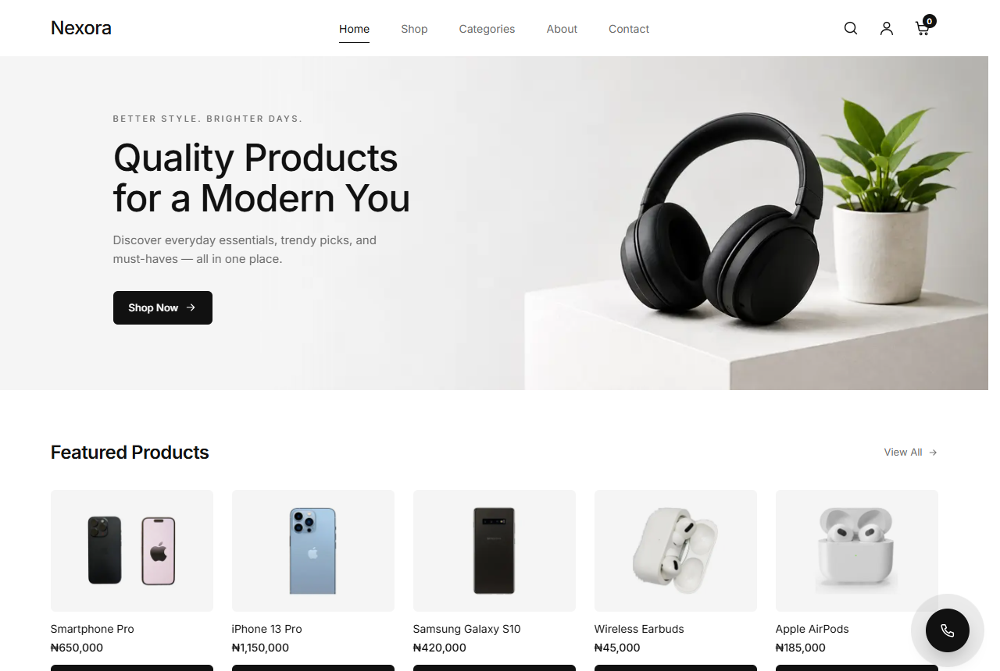
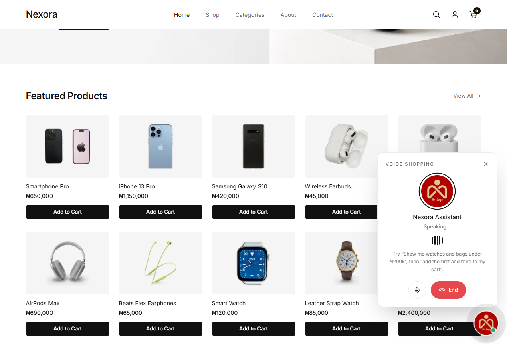
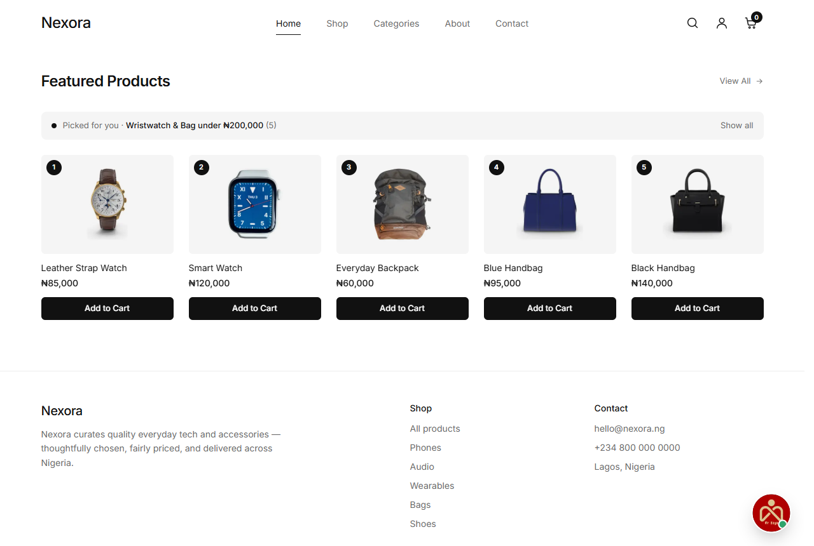
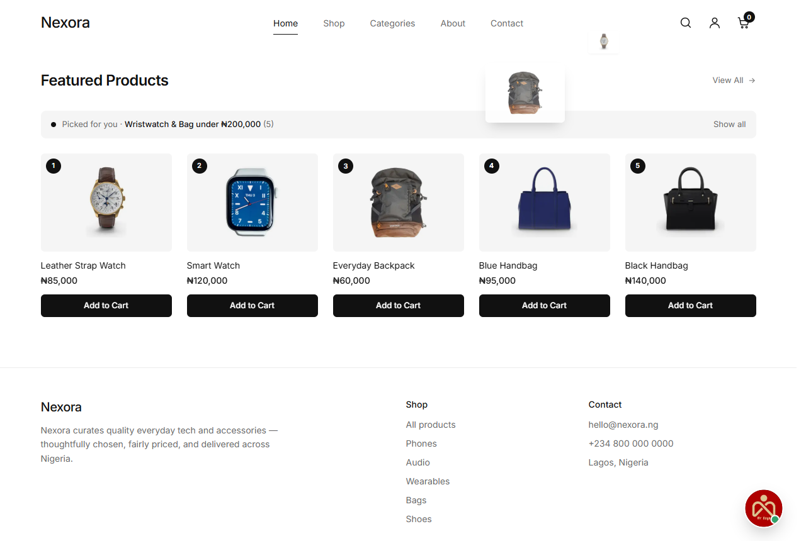
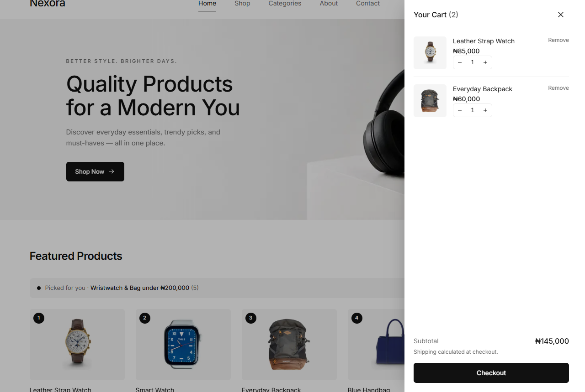

# Nexora — shop by talking

Nexora is a minimalist electronics and accessories store with a **real-time voice shopping assistant**.
Tap the ringing phone button, say what you want, and the page changes while you speak:

> "I want a wristwatch and a bag below 200,000."

The assistant searches the product database live and puts exactly the matching items on screen, numbered.
Then:

> "Add the first and the third to my cart."

Those two products pop out of their cards and fly into the cart.



## A voice shopping trip

These screenshots are from a real call with the voice agent.

**1. Tap the phone button.** The assistant answers and asks what you're shopping for.



**2. "A wristwatch and a bag below 200,000."** The page switches to exactly the matching products, numbered.



**3. "Add the first and the third to my cart."** The watch and the backpack lift off and fly into the cart.



**4. They're in the cart.**



## What's inside

```
.
├── frontend/        Next.js 16 (App Router, Turbopack, Tailwind v4) storefront
└── backend/
    ├── app/         FastAPI + SQLAlchemy API, Postgres (SQLite locally)
    └── agent/       LiveKit Agents voice worker
```

### Storefront (`frontend/`)
- A catalogue of 15 products (phones, audio, wearables, bags, shoes) on clean white backgrounds, with prices in naira.
  The data comes from the API.
- Search, category filters, product pages, and a cart drawer that persists in `localStorage`.
- **Call button.** A floating button sits at the bottom right with soft ripples while idle.
  - While ringing, it plays a ringback tone, ripples faster and wiggles.
  - Once connected, it shows the assistant's avatar, a call timer, live voice bars, and mute and end buttons.
- **Agent picks.** When the assistant shows results, the grid swaps to a numbered "Picked for you" list, so "the first" and "the third" always match what the shopper sees.
- **Fly-to-cart.** Built on the Web Animations API: each product lifts off its card, arcs, and shrinks into the cart icon in turn. It respects `prefers-reduced-motion`.

### API (`backend/app/`)
| Endpoint | Purpose |
|---|---|
| `GET /api/products` | All products. Filter with `?category=` and `?q=`, or pass `?ids=` (order preserved) |
| `GET /api/products/search?item=watch&item=bag&max_price=200000` | Multi-item search used by the assistant: each item's matches in the order asked, cheapest first |
| `GET /api/categories` | Category list |
| `POST /api/call/session` | Creates a LiveKit room, dispatches the voice agent into it, and returns a browser token |

The product table is created and seeded automatically when the API starts.

### Voice agent (`backend/agent/`)
Built on [LiveKit Agents](https://docs.livekit.io/agents/), using LiveKit Cloud inference:
- Speech-to-text: Speechmatics, with AssemblyAI as fallback.
- LLM: GPT-4.1 mini, with Gemini 2.5 Flash as fallback.
- Text-to-speech: Spitch, with Cartesia as fallback.
- Turn-taking: Silero VAD plus LiveKit's turn detector.

The agent calls the API directly through tools, with no LangChain layer, to keep latency low:

- `find_products(items, max_price, min_price)` queries the API. It then sends a `show_products` RPC to the shopper's browser, which renders those exact products.
- `add_to_cart(positions)` turns spoken positions ("first and third") into product IDs and sends an `add_to_cart` RPC, which triggers the fly-to-cart animation.
- `show_all_products` and `end_call`.

Calls have a hard time limit (10 minutes by default).

## Running locally

**API**
```bash
cd backend
python -m venv .venv && .venv/Scripts/activate   # or source .venv/bin/activate
pip install -r requirements.txt
cp .env.example .env    # fill in LiveKit keys; leave DATABASE_URL empty to use SQLite
uvicorn app.main:app --reload --port 8000
```

**Voice agent**
```bash
cd backend/agent
pip install -r requirements.txt
cp .env.example .env    # LiveKit keys, optional SPITCH_API_KEY, NEXORA_API_URL=http://localhost:8000
python agent.py download-files
python agent.py dev
```

**Storefront**
```bash
cd frontend
npm install
echo "API_URL=http://localhost:8000" > .env.local
npm run dev
```

Open http://localhost:3000 and tap the phone button.

## Deploying

Each part has its own Dockerfile or Next.js build and deploys as a separate service. On Railway, for example:
- `web` uses root directory `frontend` and needs `API_URL`.
- `api` uses root directory `backend` and needs `DATABASE_URL`, the LiveKit keys and `VOICE_AGENT_NAME`.
- `agent` uses root directory `backend/agent` and needs the LiveKit keys, `SPITCH_API_KEY`, `VOICE_AGENT_NAME` and `NEXORA_API_URL`.
- A Postgres database.

Secrets live only in environment variables. The `.env.example` files list every key.
